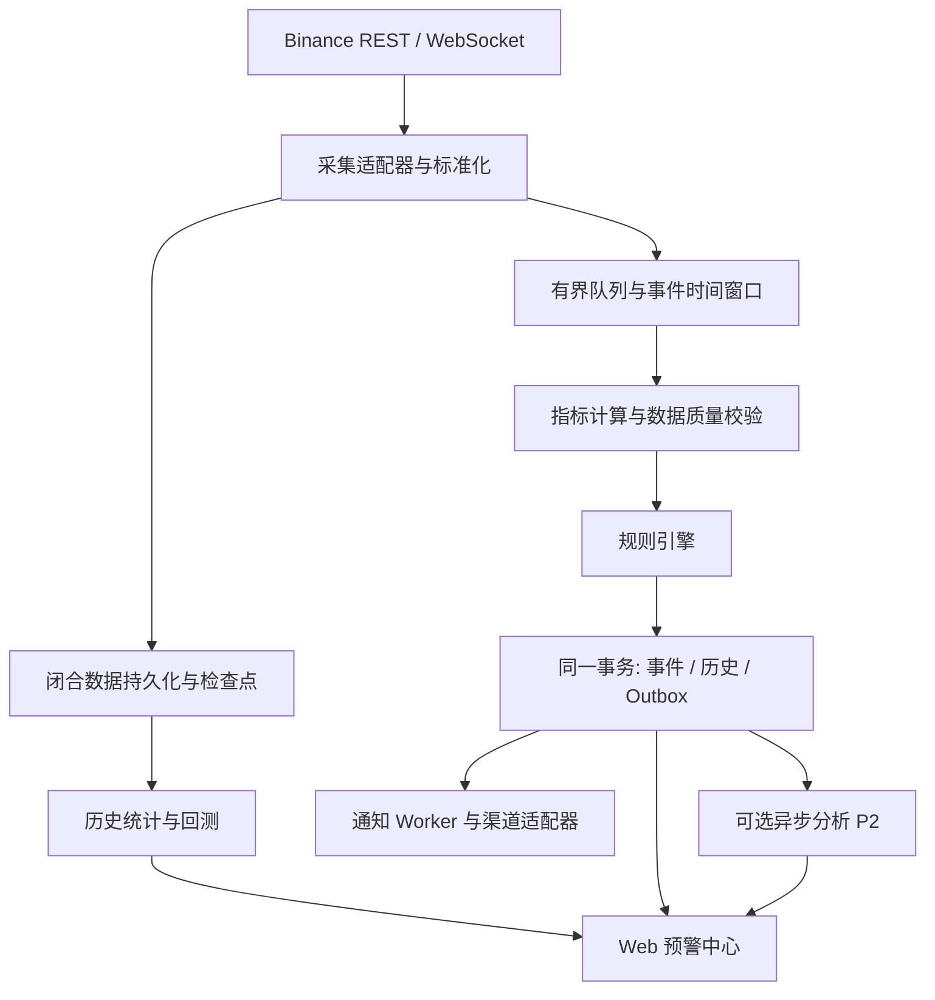

# Crypto Intelligence 设计方案

加密货币市场监控、预警与分析平台：让重要的市场信息主动找到人，而不是持续盯盘。

> [返回项目介绍](../README.md)
>
> 文档版本：v0.1 · 更新日期：2026-11-25 · 状态：设计方案，尚未实施
>
> 本文依据提供的 `crypto-intelligence-design.md` 整理。当前仓库仅包含 README 与设计文档，以下代码目录、接口、数据表、部署方式均为规划，不代表已有功能。参考文档中的代理执行指令不构成本次实施授权。

## 1. 项目定位

面向个人研究的 24×7 市场情报系统，以 Binance USD-M USDT 永续合约为首期数据源，形成 **采集 → 计算 → 检测 → 预警 → 分析 → 复盘** 的闭环。

- 全市场低成本扫描，自选币种优先采集与深度观察。
- 基于价格、成交量、持仓量（OI）、资金费率等发现异常，并展示可追溯证据。
- Web 查看行情、规则、预警与系统健康；通知渠道采用适配器隔离。
- 后续扩展现货、链上巨鲸、历史信号统计与可选 AI 分析。
- 默认单用户、中文界面、Asia/Shanghai 展示时间；数据统一按 UTC 存储。

**不在范围内：** 自动下单、交易密钥、真实资金管理、高频交易、收益保证，以及确定性判断庄家身份或市场操纵。OI 增长不能证明开多，钱包余额增加不能证明买入，信号评分不能等同胜率。

## 2. 实施范围

下表为交付阶段；与预警严重级别 P0–P3 是两个不同概念。

| 阶段 | 交付范围 | 边界 |
| --- | --- | --- |
| P0 / MVP | 合约元数据、ticker、历史/实时闭合 K 线、OI、资金费率、可用多空比；自选、基础规则、事件中心、通知、健康监控 | 无 AI 或链上密钥也能独立运行；先验证最小预警闭环 |
| P1 | 匹配现货、主动成交/CVD、自选币订单簿、链上钱包与筹码、组合信号、事件效果统计 | 先核实来源、授权与成本，不默认存在免费全量数据 |
| P2 | AI 报告、历史相似信号、评分与回测、更多数据源、Bot 查询、可选模拟交易 | 不阻塞实时预警；不得使用未来数据或宣称收益 |

数据不可获取时明确标记 `NOT_SUPPORTED` / `UNAVAILABLE`；模拟数据仅用于测试，不能冒充真实行情。

## 3. 总体设计方案

### 3.1 架构选择

采用 **模块化单体 + 独立前端 + MySQL**。首期不引入微服务、消息队列或 Kubernetes，以降低单用户部署和排障成本。

| 层次 | 建议技术 | 设计理由 |
| --- | --- | --- |
| 后端 | Java 21、兼容且仍维护的 Spring Boot 3.x、Maven | 类型化领域逻辑、成熟事务与监控体系；版本实施前核实 |
| API / 持久化 | Spring MVC、Validation、Security、MyBatis-Plus、Flyway | 参数校验、认证、数据库迁移与可追溯变更 |
| 采集 | OkHttp HTTP / WebSocket、Jackson | REST 补偿与实时订阅复用数据源适配器 |
| 指标与缓存 | 自研基础指标并单测、Caffeine；Redis 按需 | MVP 单实例无需依赖 Redis；数据库始终是事实来源 |
| 调度与监控 | Spring Scheduler、Actuator、Micrometer | 首期只使用一种调度机制，避免重复任务 |
| 数据库 | MySQL 8.x | 配置、时间序列、事件与事务 outbox；大历史量再评估 ClickHouse |
| 前端 | Vue 3、TypeScript、Vite、Pinia、Ant Design Vue、ECharts | 中文管理界面与行情可视化 |
| 部署 | Docker Compose、Nginx | 规划中的单机部署方式，尚无部署文件 |
| 扩展 | 通知适配器、链上适配器、可选 LangChain4j | 与核心规则解耦，按阶段启用 |

### 3.2 数据流



REST/WS 只出现在采集层；规则不直接处理交易所 JSON，不直接访问通知渠道。历史补录与实时输入使用明确模式隔离，默认不因补录产生通知。

### 3.3 建议代码组织

以下为未来代码组织方案，当前仅有 README 与设计文档。模块按闭环需要逐步建立，不生成占位空壳。

```text
ai2b/
├── pom.xml
├── backend/
│   ├── crypto-common/       # 标准模型、时间、精度与错误码
│   ├── crypto-market/       # 数据源适配、采集、检查点与补偿
│   ├── crypto-indicator/    # 滑动窗口、基础指标与质量判断
│   ├── crypto-strategy/     # 类型化规则与组合信号
│   ├── crypto-alert/        # 事件状态机、去重与通知任务
│   └── crypto-server/       # 启动、REST、认证、持久化与装配
├── frontend/               # Vue Web 后台
├── deploy/                 # 后续 Compose / Nginx / 环境变量样例
├── docs/
│   └── DESIGN.md           # 项目设计方案；其他工程文档后续补充
└── README.md
```

领域模型位于公共层，上层通过接口调用数据源、存储和通知实现；启动模块完成装配，禁止循环依赖。P1/P2 再按实际需要增加链上与分析模块。

## 4. 数据采集与一致性

### 4.1 候选数据源

以下为参考文档列出的候选接口，**尚未在线验证地址、限流、历史范围和地区可用性**。

| 数据 | 候选 Binance 接口/流 | 初始采集方案 |
| --- | --- | --- |
| 合约元数据 | `/fapi/v1/exchangeInfo` | 启动与每小时刷新；仅纳入 TRADING、PERPETUAL、USDT 报价/保证金标的 |
| 24h 行情 | `/fapi/v1/ticker/24hr`、ticker 流 | REST 快照，WS 更新，低频 REST 补偿 |
| K 线 | `/fapi/v1/klines`、kline 流 | 1m 闭合持久化；未闭合仅缓存；启动按配置补齐，建议先 7 天 |
| 标记价与资金费率 | `/fapi/v1/premiumIndex`、markPrice 流 | 最新缓存与分钟快照，展示价格口径与结算周期 |
| 已结算费率 | `/fapi/v1/fundingRate` | 历史补齐与每小时增量 |
| OI | `/fapi/v1/openInterest`、`/futures/data/openInterestHist` | 每 5 分钟错峰采样，优先自选，区分数量与名义金额 |
| 多空比 | `/futures/data/globalLongShortAccountRatio`、`topLongShortAccountRatio`、`topLongShortPositionRatio` | 按可用性 5 分钟采样；保留账户/持仓统计口径 |
| 主动成交 | K 线 taker buy volume；P1 `aggTrade` 流 | MVP 用闭合 K 线估算，P1 才采重点币逐笔 |
| 深度/强平 | P1 depth/diff depth；可选 forceOrder 流 | 校验订单簿序列；强平数据明确采样限制 |

### 4.2 标准模型与故障处理

- 标的键为 `exchange + marketType + symbol`；链上资产以 `chainId + contractAddress` 映射，避免同名币与 `1000TOKEN` 乘数混淆。
- 每条数据携带 `eventTime`、`receivedAt`、`source`、`quality`、`unit`；金额使用 BigDecimal / DECIMAL，展示时转换时区。
- 资金费率存小数，如 `0.0001 = 0.01%`；不混用成交价、标记价、指数价及基础币/报价币单位。
- 闭合 K 线按唯一键幂等写入；按事件时间计算窗口。乱序、重复和迟到数据不能重复触发实时告警。
- 断线采用指数退避加 jitter，恢复后重新订阅并从检查点补齐闭合数据；补齐完成前标记缺口，恢复规则计算须重新通过完整性检查。
- 每源独立限流与熔断；429 遵循 Retry-After。采集、规则、通知使用有界独立执行器；背压时记录缺口并补偿，不无限堆积线程或队列。
- 跟踪每币种最后成功时间、数据延迟、缺口、失败次数；陈旧阈值按数据类型配置。缺失、零分母、样本不足返回 `UNKNOWN`，不以 0 代替。
- 多周期由完整 1m 数据聚合；缺任一分钟即标记不完整，不输出伪完整 5m/15m 窗口。

## 5. 数据存储设计

| 表 | 核心内容与约束 |
| --- | --- |
| `instrument` | 交易所、市场类型、symbol、交易状态、精度、乘数；唯一标的键 |
| `market_kline` | 标的、周期、open_time、OHLC、成交量、主动买量、质量；唯一 `(instrument_id, interval, open_time)` |
| `market_oi` | 数量、名义金额、单位、event_time；唯一 `(instrument_id, event_time)` |
| `market_funding` | 标记价、资金费率、结算周期与时间；结算记录和快照保留类型，按类型与时间去重 |
| `market_long_short` | ratio_type、period、event_time、比率；唯一 `(instrument_id, ratio_type, period, event_time)` |
| `watchlist` | user_id、标的、优先级与分组；唯一 `(user_id, instrument_id)` |
| `alert_rule` / `alert_rule_version` | 当前启用状态与版本指针；不可变参数、阈值和作用域版本快照 |
| `alert_event` | fingerprint、规则版本、ACTIVE/RESOLVED、等级、起止时间、命中次数、证据 |
| `alert_event_history` | OPEN/UPDATE/ESCALATE/REMIND/RESOLVE 转换及当时证据 |
| `notification_outbox` | 事件、渠道、接收人引用、唯一 dedupe_key、payload、状态、重试时间、租约、错误与 provider_message_id |
| `notification_config` | 渠道、接收人、最低等级、汇总策略；不存明文 token |
| `collector_checkpoint` | source、stream_key、last_event_time、cursor；联合唯一 |

活动事件并发约束：`alert_event` 设置可空的 `active_fingerprint` 唯一索引；ACTIVE 写入 fingerprint，RESOLVED 在同一事务中置 NULL，使同一规则/方向/标的最多存在一个活动事件，恢复后仍能保存多个历史事件。并发首次命中冲突后读取现有事件并加锁更新，不依赖 Redis TTL 防重。

时间序列表按 `(instrument_id, event_time/open_time)` 索引；事件按状态/等级/最近时间索引；outbox 按状态/下次重试时间索引。规则修改使用版本校验，旧版本不可覆盖，事件保留触发时参数快照。

**容量假设：** 500 个币种 × 1,440 分钟约 72 万条 K 线/天，90 天约 6,480 万条，未计 OI 等数据。初期限制补录范围，监控磁盘与查询性能；1m 默认保留 90 天为设计值，实施前评估分区与归档。任何保留策略配置变更、批量清理或文件移动必须另行二次确认，本次不执行。

## 6. 指标与规则设计

### 6.1 指标口径

- **价格变化：** `(P_now / P_baseline - 1) × 100%`。MVP 使用闭合 K 线收盘价；5m 需当前与 5 分钟前收盘价及连续窗口，不混用未闭合价格。
- **RVOL：** 当前完整 5m 报价成交额 / 之前 N 个等长完整窗口平均值，排除当前窗口；N 为规则配置并要求充分预热。
- **OI 变化：** `(OI_qty_now / OI_qty_old - 1) × 100%`，按事件时间选择有效样本，不把名义价值随价格变化当增仓。
- **主动买卖差 / CVD：** buy quote − sell quote；sell = total − buy。CVD 限定同一市场、单位和起算点。
- **技术指标：** 后续增加 MA/EMA(7,25,99)、RSI(14)、MACD(12,26,9)、ATR(14)，明确周期与预热样本。

### 6.2 初始规则

阈值仅为工程示例，未回测验证；百分比在 API 中统一以小数比例保存，通过表单转换展示。

| 规则 | 窗口与示例条件 | 预警等级 |
| --- | --- | --- |
| PRICE_SURGE / PRICE_DROP | 5m 涨跌绝对值 ≥ 5%；≥ 10% 升级 | P1 / P0 |
| VOLUME_SPIKE | 5m RVOL ≥ 3，并满足最低报价成交额 | P2 |
| OI_SPIKE / OI_DROP | 15m 数量变化绝对值 ≥ 20%，采样完整有效 | P1 |
| FUNDING_EXTREME | 当前资金费率绝对值 ≥ 0.1%，展示结算周期 | P2 |
| 疑似逼空 | 价格上涨、负费率、此前 OI 增加、异常成交量；额外证据注明来源 | P1，不能仅凭 OI 推断方向 |
| 疑似多头踩踏 | 价格下跌、主动卖出增强、OI 减少 | P1 / P0，不能宣称完整爆仓统计 |

每条规则配置作用域、窗口、阈值、最低成交额、连续命中次数、恢复阈值、冷却时长和通知等级。组合逻辑采用类型化 AND/OR，不执行任意脚本。

规则输出统一为 `MATCH / NO_MATCH / UNKNOWN`，附实际值、阈值、窗口、来源、数据时间、质量、证据和反向证据。UNKNOWN 不开新事件，也不关闭已有事件。规则更新后按新版本重新校验和预热；停用立即停止检测及新增通知，旧事件和通知记录保留，已提交任务按显式策略处理。

## 7. 事件与通知设计

### 7.1 事件状态机

`ACTIVE → RESOLVED`，中间动作记录在 history 中。fingerprint 使用标的 + 规则 ID + 方向，规则版本通过证据追溯。

| 动作 | 处理与通知 |
| --- | --- |
| OPEN | 首次有效命中创建活动事件；满足通知策略时同时写 outbox |
| UPDATE | 同级重复命中仅更新证据、last_seen_at 与计数，不逐次推送 |
| ESCALATE | 等级升级立即通知，绕过默认 15 分钟冷却 |
| REMIND | 超过冷却且达到显著变化/提醒条件才通知 |
| RESOLVE | 滞回恢复阈值与连续有效恢复窗口满足后关闭；缺失数据不是恢复 |

每个应通知转换与 outbox 同事务提交。dedupe_key 由事件 ID、转换 ID、渠道、接收人构成；P2 汇总按时间桶与接收人去重。数据库解决并发一致性，不宣称内存事件天然可靠。

### 7.2 渠道与可靠性

- 预警严重级别：P0 紧急优先、P1 实时、P2 默认 30 分钟汇总、P3 仅记录；P0/P1 不等待 AI。
- Worker 用行锁/租约领取任务，网络发送在事务外执行；成功记录消息 ID，失败指数退避，租约过期可回收，重试耗尽进入 DEAD。
- 区分 429、5xx、超时和 401/403；永久权限错误进入人工处理。人工重试记录操作，不覆盖原错误链路。
- Telegram 是原方案的候选渠道，使用 HTTPS sendMessage、白名单接收人、文本转义与长度限制；token 仅服务端环境变量/secrets 提供，不入库或日志。
- Telegram 缺少通用发送幂等键：超时重试可能重复送达，采用“至少一次尝试发送 + 事件 ID 可追溯”，不承诺 exactly-once 或一定送达。
- **安全边界：** Telegram 仅可设计为发送公开市场行情摘要，启用前须确认符合企业策略；禁止发送公司内部数据、文件、目录、凭据或内部链接。企业内部通知使用经授权的钉钉渠道。本次不绑定账号、不发送消息、不上传任何内容。

## 8. Web 与 API 设计

页面包含市场总览、行情中心、币种详情、自选、预警中心、规则配置、通知日志/设置和系统监控。桌面优先、移动端适配，支持深浅主题与暂停实时排序；数据陈旧、缺失、空数据和错误态必须可见。

MVP 使用 5–15 秒 REST 轮询，后续评估 SSE。列表服务端分页，图表限制时间区间与点数，不将全部历史加载到浏览器。

API 前缀统一 `/api/v1`，响应含 requestId；错误使用明确 HTTP 状态及业务码。page 从 1 开始，size 最大 200；排序字段白名单、输入校验和写操作认证。

| 方法 | 相对路径 | 功能 |
| --- | --- | --- |
| GET | `/market/overview`、`/instruments`、`/instruments/{id}` | 总览、标的列表与详情 |
| GET | `/instruments/{id}/klines`、`/instruments/{id}/metrics` | 限定区间的 K 线与 OI/费率等历史指标 |
| GET / POST | `/watchlist` | 查询与添加自选 |
| DELETE | `/watchlist/{instrumentId}` | 移除自选 |
| GET / POST | `/alert-rules` | 查询与创建规则 |
| PUT / DELETE | `/alert-rules/{id}` | 带版本更新 / 逻辑停用，保留历史 |
| GET | `/alerts`、`/alerts/{id}` | 事件分页、证据与状态历史 |
| GET | `/notifications` | 通知状态与失败日志 |
| POST | `/notifications/test`、`/notifications/{id}/retry` | 限流测试与经授权人工重试 |
| GET / PUT | `/settings/notifications` | 通知设置，不返回 token |
| GET | `/system/collectors` | 采集健康、延迟与缺口 |
| POST / GET | `/analysis/reports`、`/analysis/reports/{id}` | P2 异步报告创建与查询 |

当前接口均未实现；实施时生成 OpenAPI，并为规则与通知等配置写操作设计二次确认和审计。

## 9. 扩展分析与安全运行

### 9.1 P1 / P2 设计约束

- 链上采集需确认区块游标、decimals、确认数、重组回滚、初始余额来源和标签可信度。交易所流入不等于卖出，未知地址不默认巨鲸，无法验证初始余额时不输出全量持币排名。
- 低位吸筹/高位分发只能作为带证据的假设；缺少链上或可验证买卖证据时仅显示市场候选。
- AI 可选且异步：只接经授权的本地或企业内部服务，不向第三方公网模型上传数据。输入为结构化证据，输出 summary、observations、hypotheses、counterEvidence、risks、missingData、watchItems；失败保留规则摘要。
- 历史统计使用首次触发时可见的数据，观察后续 1h/24h/3d/7d 收益与最大有利/不利变动；标注样本量与未成熟样本，避免未来数据、幸存者偏差和重复样本膨胀。

### 9.2 部署与监控规划

- Compose 规划包含 backend、frontend/nginx、MySQL，Redis 按需；数据库与缓存不对公网暴露，Web 默认本地/受控内网，不在本次公网部署。
- 未来 `.env.example` 仅提供 DB_*、APP_TIME_ZONE、BINANCE_REST_BASE_URL、BINANCE_WS_BASE_URL、TELEGRAM_BOT_TOKEN、TELEGRAM_CHAT_ID、PUBLIC_BASE_URL 和历史保留等占位符；真实配置不提交 Git。
- 公开行情不需要交易密钥。单用户认证采用安全密码哈希，日志脱敏，备份/恢复及配置修改流程需可审计。
- 监控 WS 重连、采集延迟、限流、缺口、队列积压、规则耗时、outbox 年龄、通知失败、磁盘和连接池；无数据不能显示健康正常。
- 通知渠道故障在 Web 可见；单渠道不可用时无法保证实时送达，恢复后按策略重试。

## 10. 实施里程碑与验收

本节仅规划后续工作，不触发代码生成、配置变更或外部调用。

| 里程碑 | 任务 | 完成标准 |
| --- | --- | --- |
| M0 工程基座 | 核实依赖/API；建立后端、前端、迁移、认证与健康检查 | 构建、测试、数据库迁移与本地启动可验证 |
| M1 最小闭环 | 元数据、1m K 线、5m 价格规则、事件/outbox、Web 事件页、通知 mock | 固定模拟急跌触发正确事件，重复输入不重复建事件；升级、恢复、重启正常 |
| M2 P0 完整 | ticker、OI、费率、多空比、自选、规则版本、页面与可靠通知 | 数据缺失可见，断线补齐、限流、重试与错误态通过验证 |
| M3 质量与运行 | 集成测试、模拟压力测试、部署与 API 文档、备份恢复说明 | P0 验收清单通过，记录实际结果与未验证项 |
| M4 扩展 | 按授权与数据可用性推进 P1，再推进 P2 | 新模块不破坏 P0，证据/成本/安全边界清晰 |

### P0 验收清单

- [ ] 从干净环境构建、启动并完成 Flyway 迁移；README 启动步骤与实际代码一致。
- [ ] 新增/下架标的、重复/乱序/迟到消息、断线重连与历史缺口补偿正确。
- [ ] 价格、RVOL、OI、资金费率的精度、单位、窗口边界与 UNKNOWN 行为单测通过。
- [ ] 模拟价格急跌验证 P0、并发去重、冷却、升级、恢复、新事件及规则版本追溯。
- [ ] 事件/history/outbox 事务原子性、任务租约回收、失败重试、DEAD 与重启恢复通过集成测试。
- [ ] 历史补录和陈旧数据不触发实时误报，缺失数据不导致错误恢复。
- [ ] Web 页面、认证、参数校验、错误态、分页、前端 typecheck/build 通过验证。
- [ ] mock 通知明确标记模拟；真实渠道仅经授权后测试，不能把 mock 成功称为真实送达。
- [ ] 模拟 500 币种约 8.3 条/秒平均闭合 K 线输入及分钟边界批量到达，报告吞吐与延迟；有效输入到 outbox 的目标 p95 ≤ 2s，不含外部网络延迟。
- [ ] 无交易接口、无硬编码 secrets、无内部数据外传；运行与恢复文档齐全。

建议测试工具：JUnit 5；MockWebServer/WireMock 验证 REST/WS 故障；条件允许时 Testcontainers MySQL 验证事务；前端组件测试与可选 Playwright。CI 不依赖真实通知 token、付费接口或交易权限。

## 11. 当前状态与待确认事项

**已完成：** 项目说明与本文设计方案。**未实施：** 后端、前端、采集、数据库迁移、通知、部署与自动化测试。当前没有可执行启动命令，不提供尚不存在的构建或部署步骤。

实施前需确认：

1. Java/Spring Boot/前端依赖兼容性及维护状态；数据源连通性、配额、历史范围和地区限制。
2. 实际币种范围、补录天数、保留容量、机器资源与压测结果。
3. 合规通知渠道、接收人和允许发送内容；真实消息发送须单独授权。
4. P1 数据授权与成本、链上初始余额与标签来源；P2 内部模型服务可用性。
5. 所有规则阈值、评分权重和性能目标均为初始假设，不是已验证的市场结论。

本系统提供市场观察与风险研究，不构成投资建议或自动交易系统。
