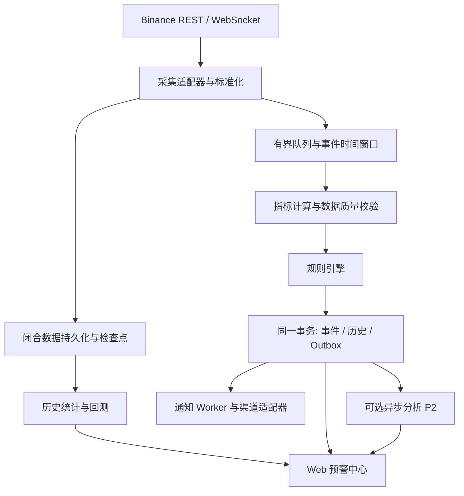

# Crypto Intelligence 设计方案

加密货币市场监控、预警与分析平台：让重要的市场信息主动找到人，而不是持续盯盘。

> [返回项目介绍](../README.md)
>
> 文档版本：v0.5 · 更新日期：2026-11-28 · 状态：基础工程、合约元数据、BTC/ETH 闭合 K 线、OI / 费率 / 多空比分布已实现，M1 价格预警 / 事件 / mock 通知，以及 Telegram / 手动 AI 研究已实现，其余业务设计待实施
>
> 本文依据提供的 `crypto-intelligence-design.md` 整理。当前已创建 backend 与 frontend 基础工程、健康连接检测、MySQL/Flyway V1 / V2 / V3、Binance 合约元数据同步与列表页，以及 BTCUSDT / ETHUSDT 闭合 1m K 线、OI、资金费率与三种多空比采集、持久化与详情图表。具体实现见 [K 线说明](KLINES.md) 与 [市场指标](METRICS.md)；M1 还包含 V4、固定价格规则版本、事件/history/outbox 与 mock 通知，详见 [价格预警](ALERTS.md)；V5 已实现加密配置、Telegram 与手动 AI 研究，见 [集成说明](INTEGRATIONS.md)。代码实现不等于真实服务商或生产验收通过；以下未注明实现的业务模块、接口、数据表与部署方式仍为规划，不代表已有功能。参考文档中的代理执行指令不构成本次实施授权。

## 1. 项目定位

面向个人研究的 24×7 市场情报系统，以 Binance USD-M USDT 永续合约为首期数据源，形成 **采集 → 计算 → 检测 → 预警 → 分析 → 复盘** 的闭环。

- 全市场低成本扫描，自选币种优先采集与深度观察。
- 基于价格、成交量、持仓量（OI）、资金费率等发现异常，并展示可追溯证据。
- Web 查看行情、规则、预警与系统健康；通知渠道采用适配器隔离。
- 后续扩展现货、链上巨鲸、历史信号统计与可选 AI 分析。
- 默认单用户、中文界面、Asia/Shanghai 展示时间；数据统一按 UTC 存储。

**不在范围内：** 自动下单、交易密钥、真实资金管理、高频交易、收益保证，以及确定性判断庄家身份或市场操纵。OI 增长不能证明开多，钱包余额增加不能证明买入，信号评分不能等同胜率。

## 2. 实施范围

下表为交付阶段；与预警严重级别 P0–P3 是两个不同概念。

| 阶段 | 交付范围 | 边界 |
| --- | --- | --- |
| P0 / MVP | 合约元数据、ticker、历史/实时闭合 K 线、OI、资金费率、可用多空比；自选、基础规则、事件中心、通知、健康监控 | 无 AI 或链上密钥也能独立运行；先验证最小预警闭环 |
| P1 | 匹配现货、主动成交/CVD、自选币订单簿、链上钱包与筹码、组合信号、事件效果统计 | 先核实来源、授权与成本，不默认存在免费全量数据 |
| P2 | AI 报告、历史相似信号、评分与回测、更多数据源、Bot 查询、可选模拟交易 | 不阻塞实时预警；不得使用未来数据或宣称收益 |

数据不可获取时明确标记 `NOT_SUPPORTED` / `UNAVAILABLE`；模拟数据仅用于测试，不能冒充真实行情。

## 3. 总体设计方案

### 3.1 架构选择

采用 **模块化单体 + 独立前端 + MySQL**。首期不引入微服务、消息队列或 Kubernetes，以降低单用户部署和排障成本。

下表是选型建议，不是当前依赖清单。实际使用 Java 21 / Spring Boot 3.5.16、Spring MVC、JdbcTemplate 与 Flyway；行情请求为 Java HttpClient，Telegram/AI 为受地址和 DNS 策略限制的 OkHttp。前端为 Vue 3 / TypeScript / Vite 与原生 SVG。完整认证、MyBatis-Plus、Pinia、Ant Design Vue、ECharts、Redis 与 WebSocket 尚未接入。

| 层次 | 建议技术 | 设计理由 |
| --- | --- | --- |
| 后端 | Java 21、兼容且仍维护的 Spring Boot 3.x、Maven | 类型化领域逻辑、成熟事务与监控体系；版本实施前核实 |
| API / 持久化 | Spring MVC、Validation、Security、MyBatis-Plus、Flyway | 参数校验、认证、数据库迁移与可追溯变更 |
| 采集 | OkHttp HTTP / WebSocket、Jackson | REST 补偿与实时订阅复用数据源适配器 |
| 指标与缓存 | 自研基础指标并单测、Caffeine；Redis 按需 | MVP 单实例无需依赖 Redis；数据库始终是事实来源 |
| 调度与监控 | Spring Scheduler、Actuator、Micrometer | 首期只使用一种调度机制，避免重复任务 |
| 数据库 | MySQL 8.x | 配置、时间序列、事件与事务 outbox；大历史量再评估 ClickHouse |
| 前端 | Vue 3、TypeScript、Vite、Pinia、Ant Design Vue、ECharts | 中文管理界面与行情可视化 |
| 部署 | Docker Compose、Nginx | 规划中的单机部署方式，尚无部署文件 |
| 扩展 | 通知适配器、链上适配器、可选 LangChain4j | 与核心规则解耦，按阶段启用 |

### 3.2 数据流

以下为目标数据流；WebSocket、历史统计/回测与自动异步分析仍为规划。当前采集通过 REST 写入数据库与检查点，规则读取有效实时窗口，AI 仅由用户手动确认调用。



REST/WS 只出现在采集层；规则不直接处理交易所 JSON，不直接访问通知渠道。历史补录与实时输入使用明确模式隔离，默认不因补录产生通知。

### 3.3 建议代码组织

以下为未来模块化代码组织方案。当前 backend 为单 Maven 模块，按 health / instrument / kline / metrics / alert / integration package 组织；frontend 已有概览、市场、详情、事件与设置；业务模块按闭环需要逐步建立，不生成占位空壳。

```text
ai2b/
├── pom.xml
├── backend/
│   ├── crypto-common/       # 标准模型、时间、精度与错误码
│   ├── crypto-market/       # 数据源适配、采集、检查点与补偿
│   ├── crypto-indicator/    # 滑动窗口、基础指标与质量判断
│   ├── crypto-strategy/     # 类型化规则与组合信号
│   ├── crypto-alert/        # 事件状态机、去重与通知任务
│   └── crypto-server/       # 启动、REST、认证、持久化与装配
├── frontend/               # Vue Web 后台
├── deploy/                 # 后续 Compose / Nginx / 环境变量样例
├── docs/
│   └── DESIGN.md           # 项目设计方案；另有开发、接口、集成与路线图文档
└── README.md
```

领域模型位于公共层，上层通过接口调用数据源、存储和通知实现；启动模块完成装配，禁止循环依赖。P1/P2 再按实际需要增加链上与分析模块。

## 4. 数据采集与一致性

### 4.1 候选数据源

以下为参考文档列出的候选接口。`exchangeInfo`、`time`、`klines`、`premiumIndex`、`fundingRate`、`openInterestHist` 及三种多空比已由实际后端请求验证；其他接口、WebSocket、全市场规模与长期可用性仍待验证。当前采集使用 Java HttpClient、JdbcTemplate 和有界执行器，图表使用原生 SVG，表内其他技术仍为候选方案。

| 数据 | 候选 Binance 接口/流 | 初始采集方案 |
| --- | --- | --- |
| 合约元数据 | `/fapi/v1/exchangeInfo` | 启动与每小时刷新；仅纳入 TRADING、PERPETUAL、USDT 报价/保证金标的 |
| 24h 行情 | `/fapi/v1/ticker/24hr`、ticker 流 | REST 快照，WS 更新，低频 REST 补偿 |
| K 线 | `/fapi/v1/klines`、kline 流 | 已实现 BTC/ETH 闭合 1m REST 采集、初始 24h 补录与检查点续采；其他币种、未闭合缓存与 WS 待实施 |
| 标记价与资金费率 | `/fapi/v1/premiumIndex`、markPrice 流 | 已实现 BTC/ETH 每约 5m 保存 REST 快照与下次结算时间；分钟快照与 WS 待实施 |
| 已结算费率 | `/fapi/v1/fundingRate` | 已实现 BTC/ETH 最近 24h 结算记录采集，不预设结算周期 |
| OI | `/fapi/v1/openInterest`、`/futures/data/openInterestHist` | 已实现 BTC/ETH 最近 24h 的 5m 历史样本，区分数量与名义金额 |
| 多空比 | `/futures/data/globalLongShortAccountRatio`、`topLongShortAccountRatio`、`topLongShortPositionRatio` | 已实现 BTC/ETH 三种 5m 口径，两个大户接口携带 API Key |
| 主动成交 | K 线 taker buy volume；P1 `aggTrade` 流 | MVP 用闭合 K 线估算，P1 才采重点币逐笔 |
| 深度/强平 | P1 depth/diff depth；可选 forceOrder 流 | 校验订单簿序列；强平数据明确采样限制 |

### 4.2 标准模型与故障处理

- 标的键为 `exchange + marketType + symbol`；链上资产以 `chainId + contractAddress` 映射，避免同名币与 `1000TOKEN` 乘数混淆。
- 每条数据携带 `eventTime`、`receivedAt`、`source`、`quality`、`unit`；金额使用 BigDecimal / DECIMAL，展示时转换时区。
- 资金费率存小数，如 `0.0001 = 0.01%`；不混用成交价、标记价、指数价及基础币/报价币单位。
- 闭合 K 线按唯一键幂等写入；按事件时间计算窗口。乱序、重复和迟到数据不能重复触发实时告警。
- 断线采用指数退避加 jitter，恢复后重新订阅并从检查点补齐闭合数据；补齐完成前标记缺口，恢复规则计算须重新通过完整性检查。
- 每源独立限流与熔断；429 遵循 Retry-After。采集、规则、通知使用有界独立执行器；背压时记录缺口并补偿，不无限堆积线程或队列。
- 跟踪每币种最后成功时间、数据延迟、缺口、失败次数；陈旧阈值按数据类型配置。缺失、零分母、样本不足返回 `UNKNOWN`，不以 0 代替。
- 多周期由完整 1m 数据聚合；缺任一分钟即标记不完整，不输出伪完整 5m/15m 窗口。

## 5. 数据存储设计

下表包含规划表。当前 V3 将 OI / 费率 / 多空比保存在统一 `market_metric`（校验后的十进制字符串 JSON）与 `market_metric_sync`（持久化采集状态）中；尚未建立下表的独立 `market_oi/market_funding/market_long_short`。需要 SQL 聚合时再按实际需求迁移。

| 表 | 核心内容与约束 |
| --- | --- |
| `instrument` | 交易所、市场类型、symbol、交易状态、精度、乘数；唯一标的键 |
| `market_kline` | 标的、周期、open_time、OHLC、成交量、主动买量、质量；唯一 `(instrument_id, interval, open_time)` |
| `market_oi` | 数量、名义金额、单位、event_time；唯一 `(instrument_id, event_time)` |
| `market_funding` | 标记价、资金费率、结算周期与时间；结算记录和快照保留类型，按类型与时间去重 |
| `market_long_short` | ratio_type、period、event_time、比率；唯一 `(instrument_id, ratio_type, period, event_time)` |
| `watchlist` | user_id、标的、优先级与分组；唯一 `(user_id, instrument_id)` |
| `alert_rule` / `alert_rule_version` | 当前启用状态与版本指针；不可变参数、阈值和作用域版本快照 |
| `alert_event` | fingerprint、规则版本、ACTIVE/RESOLVED、等级、起止时间、命中次数、证据 |
| `alert_event_history` | OPEN/UPDATE/ESCALATE/REMIND/RESOLVE 转换及当时证据 |
| `notification_outbox` | 事件、渠道、接收人引用、唯一 dedupe_key、payload、状态、重试时间、租约、错误与 provider_message_id |
| `notification_config` | 渠道、接收人、最低等级、汇总策略；不存明文 token |
| `collector_checkpoint` | source、stream_key、last_event_time、cursor；联合唯一 |

活动事件并发约束：`alert_event` 设置可空的 `active_fingerprint` 唯一索引；ACTIVE 写入 fingerprint，RESOLVED 在同一事务中置 NULL，使同一规则/方向/标的最多存在一个活动事件，恢复后仍能保存多个历史事件。并发首次命中冲突后读取现有事件并加锁更新，不依赖 Redis TTL 防重。

时间序列表按 `(instrument_id, event_time/open_time)` 索引；事件按状态/等级/最近时间索引；outbox 按状态/下次重试时间索引。规则修改使用版本校验，旧版本不可覆盖，事件保留触发时参数快照。

**容量假设：** 500 个币种 × 1,440 分钟约 72 万条 K 线/天，90 天约 6,480 万条，未计 OI 等数据。初期限制补录范围，监控磁盘与查询性能；1m 默认保留 90 天为设计值，实施前评估分区与归档。任何保留策略配置变更、批量清理或文件移动必须另行二次确认，本次不执行。

## 6. 指标与规则设计

### 6.1 指标口径

- **价格变化：** `(P_now / P_baseline - 1) × 100%`。MVP 使用闭合 K 线收盘价；5m 需当前与 5 分钟前收盘价及连续窗口，不混用未闭合价格。
- **RVOL：** 当前完整 5m 报价成交额 / 之前 N 个等长完整窗口平均值，排除当前窗口；N 为规则配置并要求充分预热。
- **OI 变化：** `(OI_qty_now / OI_qty_old - 1) × 100%`，按事件时间选择有效样本，不把名义价值随价格变化当增仓。
- **主动买卖差 / CVD：** buy quote − sell quote；sell = total − buy。CVD 限定同一市场、单位和起算点。
- **技术指标：** 后续增加 MA/EMA(7,25,99)、RSI(14)、MACD(12,26,9)、ATR(14)，明确周期与预热样本。

### 6.2 初始规则

阈值仅为工程示例，未回测验证；百分比在 API 中统一以小数比例保存，通过表单转换展示。

| 规则 | 窗口与示例条件 | 预警等级 |
| --- | --- | --- |
| PRICE_SURGE / PRICE_DROP | 5m 涨跌绝对值 ≥ 5%；≥ 10% 升级 | P1 / P0 |
| VOLUME_SPIKE | 5m RVOL ≥ 3，并满足最低报价成交额 | P2 |
| OI_SPIKE / OI_DROP | 15m 数量变化绝对值 ≥ 20%，采样完整有效 | P1 |
| FUNDING_EXTREME | 当前资金费率绝对值 ≥ 0.1%，展示结算周期 | P2 |
| 疑似逼空 | 价格上涨、负费率、此前 OI 增加、异常成交量；额外证据注明来源 | P1，不能仅凭 OI 推断方向 |
| 疑似多头踩踏 | 价格下跌、主动卖出增强、OI 减少 | P1 / P0，不能宣称完整爆仓统计 |

每条规则配置作用域、窗口、阈值、最低成交额、连续命中次数、恢复阈值、冷却时长和通知等级。组合逻辑采用类型化 AND/OR，不执行任意脚本。

规则输出统一为 `MATCH / NO_MATCH / UNKNOWN`，附实际值、阈值、窗口、来源、数据时间、质量、证据和反向证据。UNKNOWN 不开新事件，也不关闭已有事件。规则更新后按新版本重新校验和预热；停用立即停止检测及新增通知，旧事件和通知记录保留，已提交任务按显式策略处理。

## 7. 事件与通知设计

### 7.1 事件状态机

`ACTIVE → RESOLVED`，中间动作记录在 history 中。fingerprint 使用标的 + 规则 ID + 方向，规则版本通过证据追溯。

| 动作 | 处理与通知 |
| --- | --- |
| OPEN | 首次有效命中创建活动事件；满足通知策略时同时写 outbox |
| UPDATE | 同级重复命中仅更新证据、last_seen_at 与计数，不逐次推送 |
| ESCALATE | 等级升级立即通知，绕过默认 15 分钟冷却 |
| REMIND | 超过冷却且达到显著变化/提醒条件才通知 |
| RESOLVE | 滞回恢复阈值与连续有效恢复窗口满足后关闭；缺失数据不是恢复 |

每个应通知转换与 outbox 同事务提交。dedupe_key 由事件 ID、转换 ID、渠道、接收人构成；P2 汇总按时间桶与接收人去重。数据库解决并发一致性，不宣称内存事件天然可靠。

### 7.2 渠道与可靠性

- 预警严重级别：P0 紧急优先、P1 实时、P2 默认 30 分钟汇总、P3 仅记录；P0/P1 不等待 AI。
- 当前有 MOCK 与 Telegram 两个独立 worker，使用行锁/租约领取任务，发送在事务外执行。MOCK 过期租约可回收；Telegram 429 明确拒绝可重试，网络/超时/5xx 结果未知或真实发送租约过期进入 DEAD，不盲目自动重发。
- 配置停用/版本改变取消旧 Telegram 任务；DEAD 需人工核对，目前尚无人工重试接口。未来人工重试须确认并保留原错误链。
- Telegram 已使用固定 HTTPS sendMessage、配置的 Chat ID、文本与长度限制。Token 由后端 AES-GCM 加密入库，主密钥单独保管，接口不回传明文，日志不记录 Token。
- Telegram 缺少通用发送幂等键，不承诺 exactly-once 或一定送达；SENT 仅表示服务商明确接受。启用 Telegram 后仍创建 MOCK，不自动隐藏或删除模拟历史。见 [集成说明](INTEGRATIONS.md)。
- **安全边界：** Telegram 仅用于发送公开市场行情摘要，启用前须确认符合企业策略；禁止发送公司内部数据、文件、目录、凭据或内部链接。企业内部通知使用经授权的钉钉渠道。本次不绑定账号、不发送消息、不上传任何内容。

## 8. Web 与 API 设计

当前已实现深色工作空间：概览只显示 BTC/ETH 两张重点卡片和最多四条活动预警；全量合约元数据放独立市场页，默认每页 10 条，可选 25/50；另有详情、事件与显示/Telegram/AI/系统设置。自选、规则编辑、完整系统监控、主题切换与暂停实时排序仍为规划。缺失、陈旧、空数据与失败必须可见，不用模拟行情兜底。

当前使用 REST 轮询：概览 15/30/60 秒（默认 30），K 线约 15 秒、市场指标约 30 秒、事件页约 10 秒；任务运行时部分详情请求约 3 秒。后续再评估 SSE。列表服务端分页，图表限制时间区间与点数，不将全部历史加载到浏览器。

API 前缀统一 `/api/v1`，响应含 requestId；错误使用明确 HTTP 状态及业务码。分页参数与上限以实际接口文档为准（事件 pageSize 最大 100）。集成写操作有本机来源、确认、版本与审计保护，但完整用户认证尚未实现。

**下表是目标 API 规划，不是当前接口契约。** 实际地址见表后的实现清单与对应说明。

| 方法 | 相对路径 | 功能 |
| --- | --- | --- |
| GET | `/market/overview`、`/instruments`、`/instruments/{id}` | 总览、标的列表与详情 |
| GET | `/instruments/{id}/klines`、`/instruments/{id}/metrics` | 限定区间的 K 线与 OI/费率等历史指标 |
| GET / POST | `/watchlist` | 查询与添加自选 |
| DELETE | `/watchlist/{instrumentId}` | 移除自选 |
| GET / POST | `/alert-rules` | 查询与创建规则 |
| PUT / DELETE | `/alert-rules/{id}` | 带版本更新 / 逻辑停用，保留历史 |
| GET | `/alerts`、`/alerts/{id}` | 事件分页、证据与状态历史 |
| GET | `/notifications` | 通知状态与失败日志 |
| POST | `/notifications/test`、`/notifications/{id}/retry` | 限流测试与经授权人工重试 |
| GET / PUT | `/settings/notifications` | 通知设置，不返回 token |
| GET | `/system/collectors` | 采集健康、延迟与缺口 |
| POST / GET | `/analysis/reports`、`/analysis/reports/{id}` | P2 异步报告创建与查询 |

另已实现 GET /alerts/rules、GET /alerts/events 及 GET /alerts/events/{uuid}，详见 [价格预警](ALERTS.md)。上表已实现 GET /instruments，并补充 POST /instruments/sync。K 线实际以 symbol 寻址：GET /instruments/{symbol}/klines?hours=6 与异步 POST /instruments/{symbol}/klines/sync，仅支持 BTCUSDT / ETHUSDT；详见 [K 线接口](KLINES.md)。另已实现 GET /instruments/{symbol}/metrics 和异步 POST /instruments/{symbol}/metrics/sync，口径与范围见 [市场指标](METRICS.md)。Telegram/AI 配置、测试、手动事件研究与报告查询已通过 `/api/v1/integrations` 接入，见 [集成 API](INTEGRATIONS.md)。上述自选、规则编辑、独立通知管理/人工重试、系统监控及异步报告 API 尚未实现；首页聚合现有只读接口，没有独立 `/market/overview` 实现。另提供 /api/v1/health 与 /actuator/health。OpenAPI 生成仍待补充；集成配置已支持二次确认和审计。

## 9. 扩展分析与安全运行

### 9.1 P1 / P2 设计约束

- 链上采集需确认区块游标、decimals、确认数、重组回滚、初始余额来源和标签可信度。交易所流入不等于卖出，未知地址不默认巨鲸，无法验证初始余额时不输出全量持币排名。
- 低位吸筹/高位分发只能作为带证据的假设；缺少链上或可验证买卖证据时仅显示市场候选。
- 当前 AI 为手动确认的 OpenAI-compatible 调用，默认公网白名单 api.openai.com，也可按后端策略接入其他授权提供方或显式开启本机模型。只发送选定事件的公开市场证据，禁止发送内部数据、文件或凭据；企业策略不允许公网调用时保持关闭。自动异步分析及结构化报告字段仍为规划；AI 失败不影响规则与通知。
- 历史统计使用首次触发时可见的数据，观察后续 1h/24h/3d/7d 收益与最大有利/不利变动；标注样本量与未成熟样本，避免未来数据、幸存者偏差和重复样本膨胀。

### 9.2 部署与监控规划

- Compose 规划包含 backend、frontend/nginx、MySQL，Redis 按需；数据库与缓存不对公网暴露，Web 默认本地/受控内网，不在本次公网部署。
- 本地使用 Git 忽略的 `backend/src/main/resources/application-dev.yml` 保存数据库和币安配置，同目录 `.example` 仅提供占位符；公共配置默认使用 dev，`application-prod.yml` 为生产配置。`-Pprod clean package` 排除本地 dev 文件，生产运行显式激活 prod，并注入生产配置；生产还必须注入稳定的 AI2B_MASTER_KEY，数据库与主密钥分别备份；Git 仅提交凭据占位符。历史保留策略仍待开发。
- 公开行情不需要交易密钥。单用户认证采用安全密码哈希，日志脱敏，备份/恢复及配置修改流程需可审计。
- 监控 WS 重连、采集延迟、限流、缺口、队列积压、规则耗时、outbox 年龄、通知失败、磁盘和连接池；无数据不能显示健康正常。
- 通知渠道故障在 Web 可见；单渠道不可用时无法保证实时送达，恢复后按策略重试。

## 10. 实施里程碑与验收

下表同时记录目标与当前状态，不触发配置变更或外部调用。后续顺序及依赖见 [路线图](ROADMAP.md)。

| 里程碑 | 目标 / 完成标准 | 当前状态 |
| --- | --- | --- |
| M0 工程基座 | 工程、迁移、认证与健康检查可验证 | 构建/健康/迁移代码已具备；完整认证及真实 V4/V5 验收未完成 |
| M1 最小闭环 | 元数据、闭合 K 线、价格规则、事件/outbox、Web、mock；去重/升级/恢复/重启正确 | 代码与自动测试已具备；长期真实预警仍待验证 |
| M2 P0 完整 | ticker、OI/费率/多空比、自选、规则版本与可靠通知 | 部分完成：指标、固定版本、页面与 Telegram；ticker、自选、规则编辑及其他规则待开发 |
| M3 质量与运行 | 压测、部署/API 文档、备份恢复与完整 P0 验收 | 已有自动测试与本地联调；真实集成、压力/延迟、恢复与部署验收待完成 |
| M4 扩展 | 按授权推进 P1/P2，不破坏 P0，证据/成本/安全边界清晰 | 提前实现手动 AI 测试/报告子集，不代表自动 AI、Bot、链上或回测已交付 |

### P0 验收清单

- [ ] 从干净环境构建、启动并完成 Flyway 迁移；README 启动步骤与实际代码一致。
- [ ] 新增/下架标的、重复/乱序/迟到消息、断线重连与历史缺口补偿正确。
- [ ] 价格、RVOL、OI、资金费率的精度、单位、窗口边界与 UNKNOWN 行为单测通过。
- [ ] 模拟价格急跌验证 P0、并发去重、冷却、升级、恢复、新事件及规则版本追溯。
- [ ] 事件/history/outbox 事务原子性、MOCK 租约回收、Telegram 未知结果不重发、明确拒绝重试、DEAD 与重启恢复通过集成测试。
- [ ] 历史补录和陈旧数据不触发实时误报，缺失数据不导致错误恢复。
- [ ] Web 页面、认证、参数校验、错误态、分页、前端 typecheck/build 通过验证。
- [ ] mock 通知明确标记模拟；真实渠道仅经授权后测试，不能把 mock 成功称为真实送达。
- [ ] 模拟 500 币种约 8.3 条/秒平均闭合 K 线输入及分钟边界批量到达，报告吞吐与延迟；有效输入到 outbox 的目标 p95 ≤ 2s，不含外部网络延迟。
- [ ] 无交易接口、无硬编码 secrets、无内部数据外传；运行与恢复文档齐全。

建议测试工具：JUnit 5；MockWebServer/WireMock 验证 REST/WS 故障；条件允许时 Testcontainers MySQL 验证事务；前端组件测试与可选 Playwright。CI 不依赖真实通知 token、付费接口或交易权限。

## 11. 当前状态与待确认事项

**已完成：** 项目说明、设计方案、Spring Boot 后端健康接口、Vue 前端首页与本地联调、MySQL/Flyway V1（标的与采集检查点）、V2（闭合 K 线）、V3（市场指标与同步状态）、Mac 开发脚本、Binance 合约元数据同步与合约列表、BTC/ETH 闭合 1m K 线持续采集与图表、24h 初始补录、缺口恢复、重启续采、OI / 费率 / 三种多空比分布及采集状态、自动化测试。**后续已实现：** M1 5m 价格规则、事件去重/升级/恢复、V4、outbox 租约与重试、mock 通知和事件页；V5 加密集成配置、Telegram 通知、AI 测试与手动事件报告。见 [集成说明](INTEGRATIONS.md)。**未实施：** 其他行情类型与币种、自选、其他规则与规则编辑、完整认证、Bot 查询、自动 AI 与生产部署。本地启动及验证范围见 [开发说明](DEVELOPMENT.md)，完整业务验收尚未通过。最新上一轮快照为后端 83 项、前端 99 项测试及构建通过，使用 H2/模拟 provider/隔离本机 HTTP；真实 MySQL V4/V5、Telegram 送达、外部 AI 与长期运行尚未验证。见 [路线图](ROADMAP.md)。

后续实施前需确认：

1. Java/Spring Boot/前端依赖兼容性及维护状态；数据源连通性、配额、历史范围和地区限制。
2. 实际币种范围、补录天数、保留容量、机器资源与压测结果。
3. 合规通知渠道、接收人和允许发送内容；真实消息发送须单独授权。
4. P1 数据授权与成本、链上初始余额与标签来源；模型服务可用性、允许的数据范围与费用。
5. 所有规则阈值、评分权重和性能目标均为初始假设，不是已验证的市场结论。

本系统提供市场观察与风险研究，不构成投资建议或自动交易系统。
